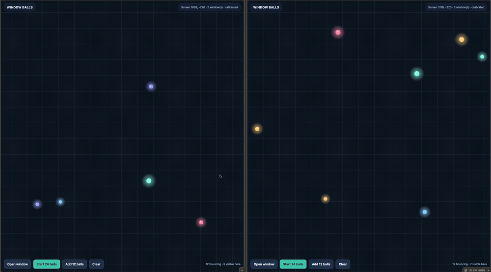

# Window Balls

A small browser game where bouncing balls move through one shared screen space and appear in each browser window at their real screen position.



## Run locally

From this repository, start a local web server:

```sh
python3 -m http.server 8765
```

Open `http://localhost:8765` in a desktop browser. Click **Open window** and arrange the windows side by side. If your browser opens a tab, drag that tab into its own window. Move your pointer inside each window once for precise alignment, then click **Start 24 balls**. Use **Add 12 balls** for more, or **Clear** to reset.

The windows communicate through `BroadcastChannel`, so they must use the same URL origin. They share each ball's starting position, velocity, and start time. Every window calculates the same position and draws only the part that falls inside its viewport. There is no transfer event to cause a visual jump. The balls bounce against the display edges, which stay fixed when a window is resized.

Pointer events calibrate the page's exact screen position. Before calibration, the page estimates the browser chrome offset. A physical gap or browser frame between windows is still visible because the ball cannot be drawn outside a web page.
